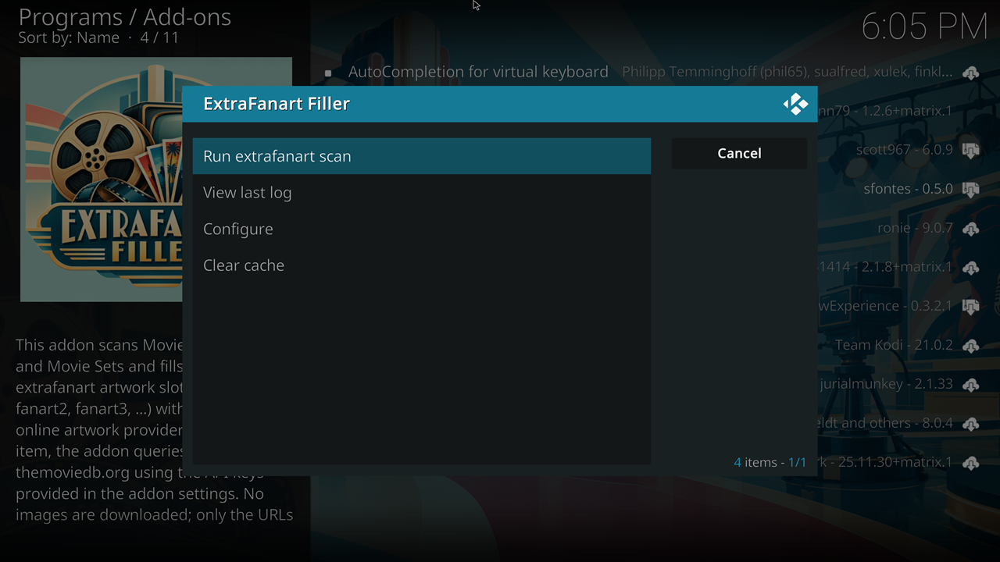
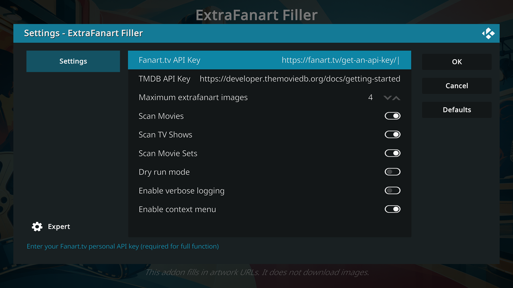

# script.extrafanart.filler

This Kodi addon discovers additional fanart (“extrafanart”) for **Movies**, **TV Shows**, and **Movie Sets** using **fanart.tv** and **TheMovieDB.org (TMDB)**.  
The addon fills in artwork URLs directly to Kodi’s `fanart1`, `fanart2`, … `fanart<n>` fields, filling gaps and extending the available extrafanart for each media item.

This addon **does not download images** and **does not use local artwork**.  
All assignments reference **remote URLs** provided by fanart.tv and TMDB.

---

## Features

- Fills in extrafanart URLs for Kodi’s `fanart1` … `fanart<n>` artwork fields  
- Supports **Movies**, **TV Shows**, and **Movie Sets**  
- Lets you enable or disable scanning for each media type  
- Uses **fanart.tv** and **TMDB** as artwork providers  
- Preserves existing artwork — does not overwrite existing `fanart<n>` entries  
- Fills gaps in the fanart sequence, starting at `fanart1`  
- Provides a manual full‑library scan from the addon’s program menu  
- Adds an optional context menu item to fill extrafanart for a single item  
- **Dry‑run mode** to simulate filling in fanart values without modifying Kodi’s database  
- **Verbose logging** option for detailed information about the scanning process 
- Generates a **run log** showing the fanarts that have been filled in for each media item 
- Maintains a **persistent provider cache** to avoid repeated API calls  
- Lets you manually clear the cache  
- Tested on **Kodi v21 (Omega)**

---

## Requirements

You must supply valid API keys:

- **fanart.tv API Key**.  
  Instructions: https://fanart.tv/get-an-api-key/.
- **TMDB API Key**.  
  Instructions: https://developer.themoviedb.org/docs/getting-started.

API keys are entered in the addon’s **Settings** panel.

---

## Installation

1. Download the addon ZIP from the Releases page.  
2. In Kodi, navigate to:  
   **Settings → Add-ons → Install from zip file**  
3. Select the downloaded ZIP to install the addon.  
4. After installation, open:  
   **Add-ons -> Program add-ons -> ExtraFanart Filler -> Configure**  
   or  
   **System -> Add-ons -> My add-ons -> Program add-ons -> ExtraFanart Filler -> Configure** 
5. Enter your TMDB and fanart.tv API keys.  
6. Configure scanning options.  
7. Access the addon menu under:  
   **Add-ons -> Program add-ons -> ExtraFanart Filler**  
   or  
   **System -> Add-ons -> My add-ons -> Program add-ons -> ExtraFanart Filler -> Run**  

---

## Configuration

### Settings Overview

- **Fanart.tv API Key**  
  Required for fanart.tv artwork.

- **TMDB API Key**  
  Required for TMDB artwork.

- **Maximum extrafanart images**  
  Number of slots to fill (`fanart1` … `fanart<n>`).  
  Range: **1–99**

- **Scan Movies / TV Shows / Movie Sets**  
  Enable or disable scanning for each media type.

- **Dry run mode**  
  Simulates filling in fanart artwork entries without writing to the Kodi database.

- **Enable verbose logging**  
  Writes details about the scanning process to the Kodi log.

- **Enable context menu**  
  Adds a context menu item to fill in extrafanart for a single Movie, TV Show, or Movie Set.

---

## How It Works

1. The addon retrieves TMDB and fanart.tv IDs for each media item.  
2. It fetches available backdrop URLs from both providers (online or cached).  
3. Existing `fanart<i>` entries are inspected to determine the next free slot.  
4. New fanart URLs are filled in sequentially, filling gaps first.  
5. Filled in fanart slots are recorded in the run log.  
6. Provider results are cached for future runs.

---

## Caching

The addon stores artwork URLs returned by fanart.tv and TMDB in a persistent cache.  
When a cached entry exists for a media item:

- The addon **does not contact the provider again**  
- The cached URL list is used to fill in the fanart URLs for the media item.

For example, a dry run populates the cache without modifying Kodi’s database.
A subsequent normal run uses the cached URLs and assigns them to the fanart of the items.

Cached entries never expire automatically.
If fanart.tv or TMDB adds new artwork for an item you already scanned, you must clear the cache to pick up the new images.

You do not need to clear the cache when you add new Movies, Movie Sets, or TV Shows.
New items are not in the cache, so the addon contacts the providers normally.

A menu option lets you clear the entire cache, forcing a full re-scan on the next run.

---

## Limitations

- Artwork is **not downloaded**; only URLs are filled in for the fanart<n> artwork of an item.  
- Cached provider results are **never evicted automatically**.  
- Movie Sets require **both** TMDB and fanart.tv to be available (online or cached)
- The addon does not run automatically; you must trigger scans manually or via the context menu.
- Artwork is used in the order it is returned from the artwork providers. First from fanart.tv, then from TMDB. The addon does not rate, reorder, or filter the results.

---

## License

This project is licensed under the **GPLv2** license.
